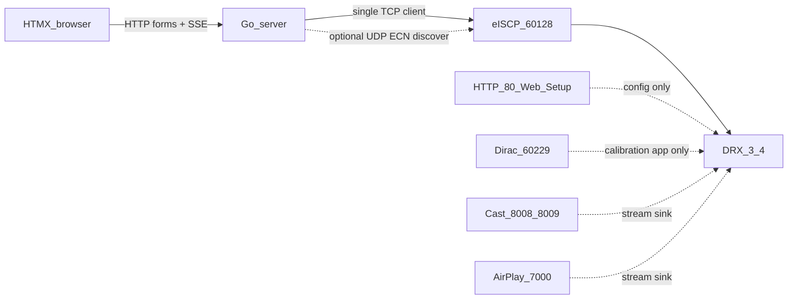

# Integra DRX-3.4 — responsive web remote plan

Plan for a LAN web app that controls the Integra **DRX-3.4** via eISCP. Companion docs: [`README.md`](README.md) (ops / defaults), [`PROTOCOL.md`](PROTOCOL.md) (packet framing). Device address and preferred defaults live in [`.env`](.env).

Includes research findings (Aug 2026) on network surfaces beyond the original Tier 1 sketch — what to add as product features vs leave to other apps.

---

## Goal

A **responsive web remote** for phones and desktops on the LAN that can:

- Change volume, mute, power, input, listening mode, centre/dialogue trim, Late Night
- Switch **Dirac Live Off / Slot 1–3** and **EQ presets** without opening the Dirac / Control Pro apps
- Show live status (input, A/V path, front-panel text, temperature, firmware, HDMI/BT health)
- Pick a **NET streaming service** (AirPlay, Chromecast, Spotify, TIDAL, …) then transport / now-playing
- Optionally cover zones and tuner later
- Optionally **auto-discover** the amp on the LAN (UDP `ECN`) instead of only hardcoding `.env`

Primary control path is **eISCP TCP `60128`**. The amp’s HTTP Web Setup page is **not** a control API. Cast / AirPlay ports are stream sinks, not our primary remote protocol.

---

## Chosen stack (locked)

| Layer | Tech | Why |
|-------|------|-----|
| **Backend** | **Go** (`net/http` + one persistent `net.Conn` to eISCP) | Single binary; one goroutine owns the amp socket and fans out events; no Node/Python runtime required on the LAN box |
| **Frontend** | **HTMX** + server-rendered HTML (`html/template`) | Controls are buttons / sliders / forms — POST → HTML fragment swap fits a remote better than a SPA |
| **Live updates** | **SSE** (HTMX `sse` / `sse-swap`) | Unsolicited eISCP notices (volume / input / power) push HTML patches without a heavy WebSocket client |
| **CLI helper** | Keep [`eiscp_send.py`](eiscp_send.py) | Debug, `apply-defaults`, capability probes — **not** the web runtime |

Prefer this over React + a separate JSON API: one language for I/O and templates, no UI build step, amp state stays authoritative on the server.



---

## Network endpoints (this unit)

Live probes (read-only) against this DRX-3.4:

| Endpoint | Role for the web remote |
|----------|-------------------------|
| **TCP 60128 eISCP** | **Yes — primary.** Volume, input, modes, Dirac **slots** (`DSS`/`DSSC`), EQ (`EQS`), zones, A/V info, NET/`NSV`, `NRI`, `FWV`, status |
| **UDP 60128 `ECN`** | **Yes — discovery.** Broadcast/unicast `!xECNQSTN` → `ECNDRX-3.4/60128/…/MAC`. Optional auto-find / verify address+port |
| **HTTP :80** Web Setup (basic auth from `.env`) | Device name, login, network, Control4 identify, firmware upload. `/api/` → 403. **Not** day-to-day remote |
| **TCP 60229** Dirac | Measurement / filter push for Dirac Live **app**. NRI: `<control id="Dirac" port="60229"/>`. **Not** our remote — use eISCP `DSS`/`DSSC` for slot select |
| **TCP 8008 / 8009** Chromecast built-in | Cast receiver (`eureka_info` live). Stream sink / Cast-session volume only — **do not** build the remote on Cast protocol |
| **TCP 7000** AirPlay | AirTunes / AirPlay 2 receiver (`AirTunes/366.0` live). Stream sink — **not** primary remote |
| UDP 1902 SDDP / Domotz / OvrC | Installer discovery / monitoring — out of scope |
| RS-232 / IR / 12V / Control4 / Sonos Port | Parallel integrations — out of scope for this Go+HTMX app |

**Hard constraint:** the Go process keeps **one** persistent eISCP TCP connection (port mutex). Browsers never talk to `60128`. Port framing from [`eiscp_send.py`](eiscp_send.py) / [`PROTOCOL.md`](PROTOCOL.md) into a small Go `eiscp` package.

---

## What research adds (product features)

Versus the original Tier 1 sketch (power / volume / mute / input / mode / centre / Late Night / defaults), these are the **user-facing** additions:

| Feature | ISCP / path | Why add |
|---------|-------------|---------|
| **Dirac Off / Slot 1–3** | `DSSQSTN`; set `DSSC00`–`DSSC03` (community-verified syntax; query returns e.g. `000` = Off) | Everyday Room EQ profile switching without Dirac PC / Control Pro. **Highest-value gap.** |
| **EQ preset On/Off / presets** | `EQS` (`EQSQSTN` → `00` live) | Separate from Dirac; quick EQ control |
| **NET service picker** | `SLI2B` then `NSV…`; labels from `NRI` `netservicelist` (TuneIn, Spotify, AirPlay `44`, Chromecast `40`, Play-Fi `42`, Alexa `45`, TIDAL, USB, Music Server, Play Queue, …) | Jump to a streaming path; Tier 4 already had transport/now-playing — this adds **which service** |
| **Amp auto-discovery** | UDP `ECN` | Ops convenience; softens hard-coded `.env` IP |
| **Richer status** | `TPD` (temp, live `F 80C 27`), `FLD` (FL text, e.g. Shield + volume), `HAO`/`HOI` (HDMI audio/out), `NSB`/`NDS` (BT / NET health) | Status strip / detail panel beyond IFA/IFV |
| **Advanced audio toggles** (gated) | `AVS`, `RAS`, `DGF`, `CTS`, `DLC`/`DCE` (query often works; **set** path-dependent) | Optional Advanced section only |

### Explicitly not product features of this app

| Surface | Why skip as a remote feature |
|---------|------------------------------|
| Become a Cast / AirPlay **client** | Phones already cast/stream to `:8008` / `:7000` |
| Drive Dirac **calibration** on `:60229` | Interrupts listening; use official Dirac / Control Pro |
| Sonos Works With / Alexa / Play-Fi / FlareConnect | Other ecosystems; no open DIY LAN API we need |
| Control4 SDDP / Domotz / OvrC | Discovery / monitoring for installers |
| Roon RAAT | Unit is **Roon Tested**, not Roon Ready |
| Dealer `MEM STR/RCL` as primary UX | Niche; gate if ever exposed |
| “Support newer ISCP spreadsheet” alone | Docs/coverage improvement — enables Dirac `DSS*`, not a UI feature by itself |

**Protocol inventory source of truth for Phase 0:** prefer community **ISCP_AVR_146** (and derived YAML) over 2013–2017-only maps so Dirac `DSS*` and late commands are included. Still **probe live** before enabling UI controls.

---

## Architecture

### Go process responsibilities

1. Connect (and reconnect) to `address:60128` from `.env` (or from optional UDP `ECN` discovery)
2. Own a write mutex + command queue (≥ 50 ms spacing)
3. Parse ISCP replies and unsolicited notices into an in-memory **state store**
4. Serve HTML pages and HTMX fragments over HTTP (LAN bind, e.g. `:8080`)
5. Fan out state changes to SSE clients as HTML fragments (or small event payloads that swap known targets)
6. On startup / after power-on (optional): re-apply `.env` defaults (`LMD`, `MVL`, `CTL`, `LTN`) because `CTL`/`LTN` are temporary
7. Cache `NRI` (selectors, net services, control ranges, Dirac flag) for UI labels

### Suggested package layout

```
cmd/integra-web/          # main: HTTP + eISCP lifecycle
internal/eiscp/           # packet encode/decode, client, reader loop, optional UDP ECN discover
internal/state/           # thread-safe AVR snapshot (PWR, MVL, SLI, DSS, IFA, FLD, …)
internal/web/             # handlers, templates, static (htmx.min.js), SSE hub
configs / .env loading    # address + preferred defaults (no secrets in repo)
```

### HTTP surface (initial)

| Method | Path | Purpose |
|--------|------|---------|
| `GET` | `/` | Main remote page (Tier 1 + status strip) |
| `POST` | `/cmd/...` | Form actions (power, vol ±, mute, input, mode, CTL, LTN, **DSS/EQS**, apply-defaults, …) → fragment or redirect |
| `GET` | `/sse` | Server-Sent Events stream of status fragment updates |
| `GET` | `/status` | Optional full status fragment (poll fallback) |
| `GET` | `/healthz` | Process up + eISCP connected bool |

No browser-facing JSON API required for v1; HTMX posts and HTML swaps are enough. A small `/api/state` JSON endpoint can be added later for debugging.

### UI composition (responsive)

One composition for the first viewport on a phone:

1. **Status strip** — power, input name, display volume, mute, listening mode, **Dirac slot** (SSE-updated); optional FL text / temp
2. **Volume** — large ± and absolute slider (encode display ↔ `MVL` hex with unit’s half-scale rule)
3. **Primary actions** — mute, apply dialogue defaults, power
4. **Input grid** — renamed selectors from live list / `NRI`
5. **Dialogue / mode / Room EQ** — Straight Decode vs others, centre trim, Late Night, **Dirac Off/Slot1–3**, **EQS**
6. Below fold / secondary: A/V detail (`IFA`/`IFV`/`FLD`/`TPD`/`HAO`/`HOI`), **NET service picker + now-playing**, zones, tuner, advanced

Mobile-first CSS; no SPA router. Prefer one scrollable remote page for Tier 1, then section/tabs as tiers grow.

---

## Feature tiers

### Tier 1 — Day-to-day remote (build first)

| Feature | ISCP | Notes on this DRX-3.4 |
|---------|------|------------------------|
| Power on/standby | `PWR` | Verified |
| Master volume | `MVL` | Hex absolute; display ≈ value/2 (see README) |
| Mute | `AMT` | `00` / `01` / `TG` |
| Input select | `SLI` | Live renamed list: XBOX / GAME / PS5 / Shield / PC / AUX / CD / TV / PHONO / AM / FM / NET / BT (+ Zone “Source” `80`) |
| Listening mode | `LMD` | Preferred `40` Straight Decode; `82` Neural:X often hurts dialogue on 3.1 |
| Centre (dialogue) trim | `CTL` | −12…+12 dB; **temporary** (may reset after standby) |
| Late Night | `LTN` | `00` off / `01` low verified; `02` N/A here |
| **Dirac Live slot** | `DSS` / `DSSC` | **Verified query** `DSSQSTN` → `000` (Off). Set via `DSSC00`–`DSSC03` (Off / Slot1–3). Day-to-day Room EQ — **not** `:60229` calibration |
| **Equalizer select** | `EQS` | **Verified query** `EQSQSTN` → `00`. Off / presets |
| Sub temp trim | `SWL` | Verified queryable |
| Front tone | `TFR` | Bass/treble (flat `B00T00` observed) |
| Apply defaults | LMD+MVL+CTL+LTN (+ optional DSS/EQS later) | Already in `.env` / `apply-defaults` |

### Tier 2 — Status / telemetry

| Feature | ISCP | What you show |
|---------|------|----------------|
| Audio path | `IFA` | Jack, codec, sample rate, in-ch, mode name, out-ch |
| Video path | `IFV` | Jack, in/out resolution, color, bit depth, HDMI out |
| Live scalars | `SLI` `MVL` `AMT` `LMD` `CTL` `LTN` `DSS` `EQS` | Dashboard / status strip |
| Front-panel text | `FLD` | **Verified** (hex-encoded FL string, e.g. Shield + volume) |
| Temperature | `TPD` | **Verified** (e.g. `F 80C 27`) — show in detail panel |
| HDMI output / audio / out info | `HDO` `HAO` `HOI` | **Verified** (`HDO01`, `HAO02`, `HOI11`) |
| Audio selector | `SLA` | Observed `04` |
| Dimmer / display / sleep | `DIM` `DIF` `SLP` | Verified |
| CEC | `CEC` | On observed |
| Music Optimizer | `MOT` | Verified |
| Cinema filter / Re-EQ | `RAS` | **Verified** query (`00`) |
| A/V sync | `AVS` | **Verified** query (`0000`) |
| BT / NET link | `NSB` `NDS` | **Verified** (`NSB=ON`, `NDS=E-x`) |
| Device capability dump | `NRI` | XML: model, zones, selectors, net services, Dirac port, ranges — UI label source of truth |
| Firmware | `FWV` | e.g. `R136-0815-1282-0033-0000` |
| Auto power-down / Eco / APS | `APD` `ECO` `APS` | Model-dependent (`APS` answered `01`; `ECO` → `N/A`) |

### Tier 3 — Zones (Main + Zone2 + Zone3; no Zone4)

| Zone | Power | Vol | Mute | Input | Tone/balance |
|------|-------|-----|------|-------|--------------|
| Main | `PWR` | `MVL` | `AMT` | `SLI` | `TFR` / `CTL` / `SWL` … |
| Zone 2 | `ZPW` | `ZVL` | `ZMT` | `SLZ` | `ZTN` `ZBL` |
| Zone 3 | `PW3` | `VL3` | `MT3` | `SL3` | `TN3` `BL3` |
| Zone 4 | `PW4`… | — | — | — | **No reply** on this hardware |

Zone2/3 also have NET/tuner variants (`NTZ`/`TUZ`/`PRZ`, `NT3`/`TU3`/`PR3`) when those sources are used. NRI confirms zones 1–3 enabled, zone 4 `value="0"`.

### Tier 4 — NET / USB / Bluetooth / AirPlay

| Area | Commands | Product note |
|------|----------|--------------|
| **Service picker** | `NSV` (+ `SLI2B` NET first); labels from `NRI` `netservicelist` | **Add explicitly** — open AirPlay / Chromecast / Spotify / TIDAL / … path |
| Transport | `NTC` / `NTZ`… — PLAY PAUSE STOP TRUP TRDN FF FR etc. | When a NET/BT path is active |
| Now playing | `NAT` `NAL` `NTI` `NTM` `NTR` `NST` | Metadata panel |
| Lists / jacket | `NLS` `NLA` `NLU` `NJA` `NLT` `NPB`; favorites `NAF`/`NRF` | Browse when useful |
| Keyboard / popup | `NKY` `NPU` | As needed |
| Connection status | `NDS` `NSB` | Show in status |
| Bluetooth | `NBS` `NBT` | Pairing / BT path |
| AirPlay metadata | `AAT` `AAL` `ATI` `ATM` `AST` | When AirPlay path active |

Useful for a “now playing” + service panel when input is NET/BT; less critical for HDMI Shield movie watching. Do **not** reimplement Cast/AirPlay protocols — only eISCP selection + status.

### Tier 5 — Tuner / radio

| Feature | Commands |
|---------|----------|
| AM/FM tune & presets | `TUN` `PRS` `PRM` |
| RDS / PTY / TP | `RDS` `PTS` `TPS` (where supported) |
| Zone tuner mirrors | `TUZ`/`PRZ`, `TU3`/`PR3` |

Inputs `SLI24` FM / `SLI25` AM exist on this unit’s selector list.

### Tier 6 — Advanced audio / video (expose carefully)

**Dialogue / dynamics (path-dependent)**

- `DLC` / `DCE` Vocal/Dialog — in `NRI`, **query** often returns `00`; **set** often **N/A** on DTS-HD + Straight Decode (use `CTL` + `LTN` instead for that path)
- `SCD`, `CTS` (center spread **verified** query), PLII/Neo music params (`PNR` `DMS` `CTW` `CTI`)
- Audyssey: `ADY` `ADQ` `ADV` — Dynamic EQ query empty in probes on this unit
- Dolby Volume `DVL`, AccuEQ `AEQ`, phase `PCT`/`PCP`, LFE `LFE`
- A/V sync `AVS` (**verified**), lip-sync `LPS`, filter family `DGF` (**verified** `03`); `ASC`/`UPS`/`HBT` no reply here

**HDMI / video**

- `HAO`/`HAS` (**HAO verified**), `HOI` (**verified**), `RES`, `SPR`, `HST`, `ARC`, `CCM`
- Picture: `VPM` `VWM` `ISF` (Japanese `VOS` N/A here)

**Tone per speaker group**

- `TCT` `TSR` `TSB` `TSW` `TFH` `TFW`, `PMB`, temp levels `TCL` / `SW2`

**System / integration**

- OSD keys `OSD`, memory `MEM` STR/RCL (**not** durable `CTL` save; dealer-oriented)
- Triggers `TGA` `TGB` `TGC`, speakers `SPA` `SPB` `SPL`, channel mute `CMT`
- Rename `IRN`, IntelliVolume `ITV`, dual-mono `DMN`
- `UPD` / `RST` — **dangerous; keep out of casual UI**

**Do not put on a casual remote (or gate hard)**

- `SLC` speaker level calibration — **plays test tones**
- Permanent / measurement calibration → Dirac app on **`:60229`** (or Setup UI) — **not** eISCP `CTL`; slot **select** stays on `DSS`/`DSSC`
- Blind `RST` / `UPD`

---

## Capability discovery rule

Community maps ([onkyo-eiscp](https://github.com/miracle2k/onkyo-eiscp), [ISCP_AVR_146](https://github.com/miracle2k/onkyo-eiscp/issues/148)) list **~200+** distinct 3-letter commands across the Onkyo/Integra family. Many are model- or region-specific. Classic YAML alone misses late commands such as Dirac `DSS*`.

**Rule for the web UI:** discover live via `NRIQSTN` + probe `*QSTN`; only enable controls the unit answers.

Already verified responding on this amp (non-exhaustive): `PWR` `MVL` `AMT` `SLI` `LMD` `CTL` `LTN` `DSS` `EQS` `IFA` `IFV` `FLD` `TPD` `HDO` `HAO` `HOI` `SLA` `DIM` `DIF` `SLP` `CEC` `NRI` `FWV` `SWL` `TFR` `MOT` `RAS` `AVS` `DGF` `CTS` `DLC` `DCE` `APS` `NSB` `NDS` `ZPW`/`ZVL`/`ZMT`/`SLZ` `PW3`/`VL3`/`MT3`/`SL3` `TUN`/`PRS`, NET metadata stubs, UDP `ECN`. Zone4 and several legacy codes: **no response**.

---

## Non-goals / expectations

The app should **not** expect:

- A REST API on the amp itself (HTTP is setup-only)
- Permanent centre-level save via eISCP (`CTL` is temporary — re-apply from `.env`)
- Vocal/Dialog (`DLC`) **set** always available (codec/mode dependent; query may still work)
- Multiple simultaneous eISCP clients without this proxy mutex
- To **calibrate** Dirac over `:60229` from this remote (slot **select** via `DSS`/`DSSC` **is** in scope)
- To implement Cast, AirPlay, Sonos, Play-Fi, or Alexa as first-class clients
- Control4 / Domotz / OvrC monitoring features

---

## Preferred defaults (product behaviour)

From `.env` (dialogue-friendly 3.1):

| Setting | ISCP | Meaning |
|---------|------|---------|
| Listening mode | `LMD40` | Straight Decode |
| Master volume | `MVL50` | Display Volume **40.0** |
| Centre trim | `CTL+10` | +10 dB temporary dialogue boost |
| Late Night | `LTN01` | Low |

UI should expose an **Apply defaults** action (same as `eiscp_send.py apply-defaults`) and optionally auto-reapply after standby → on.

Optional later: persist a preferred **Dirac slot** / `EQS` in `.env` and include in apply-defaults once slot behaviour is confirmed with a set+query round-trip on this unit (query already verified; prefer a quiet moment to verify `DSSC` sets).

---

## Delivery phases

### Phase 0 — Docs & probes (inventory)

1. ~~Add [`CAPABILITIES.md`](CAPABILITIES.md)~~ **Done** — endpoint map, ISCP_AVR_146 + live `NRI`/`QSTN`, Dirac `DSSC` notes
2. ~~Link from [`README.md`](README.md)~~ **Done**
3. Extend [`eiscp_send.py`](eiscp_send.py) with read-only `capabilities` (`FWV` + summarized `NRI` + `DSS`/`EQS`/`TPD`) — **no amp state changes** (remaining)

### Phase 1 — Go eISCP core

- `internal/eiscp` packet framing + persistent client + reconnect
- Optional UDP `ECN` discovery helper
- State store updated from replies / unsolicited notices (include `DSS`, `EQS`, `FLD`, `TPD`)
- CLI smoke test or `/healthz` proving connection
- Volume encode/decode helpers (hex ↔ display)

### Phase 2 — Tier 1 web remote

- `cmd/integra-web` serving HTMX remote
- Power, volume, mute, input, `LMD`, `CTL`, `LTN`, **Dirac slots (`DSS`/`DSSC`)**, **`EQS`**, apply-defaults
- SSE status strip (include Dirac / mode)
- Responsive layout for phone + desktop
- Config from `.env` (host bind + amp address + defaults)

### Phase 3 — Tier 2 status polish

- A/V path panel (`IFA`/`IFV`), **`FLD`**, **`TPD`**, firmware (`FWV`), `NRI`-driven labels
- HDMI extras `HAO`/`HOI`/`HDO`; BT/NET `NSB`/`NDS`
- Dimmer / sleep / CEC as secondary controls

### Phase 4 — Zones, NET service picker, tuner (as needed)

- Zone2/3 pages or sections
- **NET service picker (`NSV`)** + now-playing when input is NET/BT
- AM/FM when on tuner inputs

### Phase 5 — Advanced (gated)

- Path-dependent dialogue (`DLC`), `CTS`, `AVS`, `RAS`, `DGF`, Audyssey/HDMI extras behind “Advanced”
- Explicitly exclude calibration tones / `:60229` measurement / reset / update from default UI

---

## Implementation notes

- **Spacing:** ≥ 50 ms between eISCP writes
- **Authority:** UI always reflects server state store, not optimistic-only; SSE corrects races
- **Dirac sets:** confirm `DSSC0x` with query on this unit before shipping the control (query already live; set syntax from TX-RZ50 community reports)
- **Auth (optional later):** LAN-only first; basic auth or reverse-proxy auth if exposed beyond trusted LAN
- **Static assets:** vendor HTMX locally (no CDN required for offline LAN use)
- **Logging:** connection up/down, command send/fail, not `.env` secrets
- **Python CLI stays:** web app does not replace `eiscp_send.py` for ad-hoc debugging

---

## Success criteria (Phase 2)

- From a phone on the LAN, open the remote and change volume / input / mute without the amp’s own app
- Status strip updates when volume is changed on the physical remote (unsolicited eISCP → SSE)
- **Apply defaults** restores Straight Decode + volume 40 + centre +10 + Late Night Low
- **Dirac slot** can be read and switched from the UI (Off / Slot1–3) via eISCP — without using `:60229`
- Only one eISCP TCP session is open while the Go app runs

---

## Related files

| File | Role |
|------|------|
| [`.env`](.env) | Amp address, Web Setup creds, preferred ISCP defaults |
| [`README.md`](README.md) | How to use Web Setup vs eISCP, cheat sheet |
| [`PROTOCOL.md`](PROTOCOL.md) | eISCP framing and command groups |
| [`eiscp_send.py`](eiscp_send.py) | CLI helper (`status`, `raw`, `apply-defaults`, future `capabilities`) |
| [`CAPABILITIES.md`](CAPABILITIES.md) | Control-surface inventory (ISCP_AVR_146 + live `NRI`/`QSTN`; Dirac `DSSC` verified) |
| This file | App plan (stack, architecture, tiers, research takeaways, phases) |
